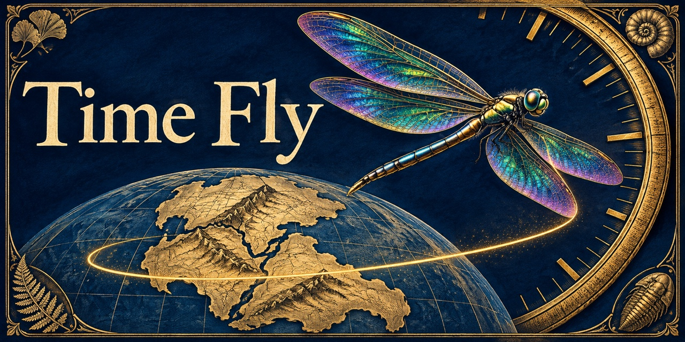

# Time Fly



Explore the last 540 million years of Earth's history on an interactive 3D globe. Drag the globe to rotate it, scroll to zoom, and move the time slider to watch continents drift, coastlines shift, and ice sheets retreat.

[Play Time Fly in a WebGPU browser](https://adsouza.github.io/time-fly/).

## Run from source

Time Fly uses Rust and Bevy. With `rustup` and `uv` installed, run these commands from the repository root to fetch the datasets, build the globe, and launch the desktop app.

```sh
cd tools/bake
uv run --locked timefly-fetch --sources ../../data/sources.json --raw ../../data/raw
uv run --locked timefly-bake --raw ../../data/raw --out ../../crates/timefly/assets/data/globe
cd ../..
cargo run --locked -p timefly
```

To explore the same globe in a WebGPU browser, run the following from the repository root and open the URL printed in the terminal.

```sh
cargo install --locked wasm-server-runner
cd crates/timefly
cargo run --locked --profile web-release --target wasm32-unknown-unknown -p timefly
```

[Globe datasets and credits](data/README.md) · [License](LICENSE)
